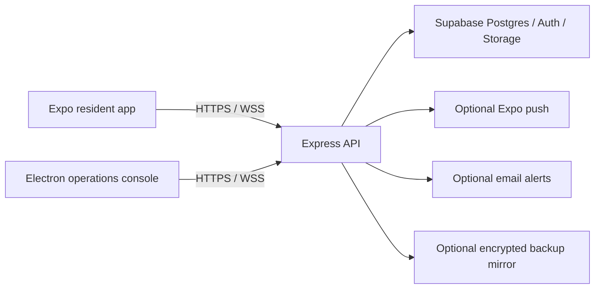
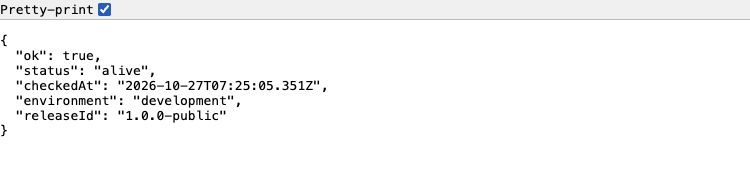

# Property Portal · Server

An **Express and Supabase** backend connecting a resident mobile app with an Electron operations console. It centralizes maintenance workflows, resident and building records, conversations, reports and operational health.

[Mobile app](https://github.com/earlyad4/property-portal-mobile) · [API server](https://github.com/earlyad4/property-portal-server) · [Desktop console](https://github.com/earlyad4/property-portal-desktop)

## Features

- Separate resident and operator authentication paths.
- Buildings, units, resident rosters and technician management.
- Maintenance requests, assignment, status updates and ticket conversations.
- Building broadcasts, quality reports and document metadata.
- WebSocket events and optional Expo push notifications.
- Maintenance analytics and PDF/Excel exports.
- Liveness/readiness endpoints, client-version checks, incident alerts and optional encrypted backups.
- PostgreSQL schema and row-level security migrations.

## System layout



## Screenshots

Actual local API liveness response. The screenshot process uses placeholder credentials and no reachable database. Liveness confirms the process is running; it does not prove database readiness.



The [mobile gallery](https://github.com/earlyad4/property-portal-mobile#screenshots) and [desktop gallery](https://github.com/earlyad4/property-portal-desktop#screenshots) show the client workflows using synthetic records.

## Quick UI preview — no services required

```sh
git clone https://github.com/earlyad4/property-portal-server.git
cd property-portal-server
npm run demo
```

The demo uses Node's built-in HTTP server and runs on `127.0.0.1:4318`. It serves newly authored, read-only synthetic fixtures. It never connects to a database, sends messages or persists records. Point the clients to this origin as described in their READMEs. This helper is a UI preview, not the actual backend or a deployable service.

## Configure a connected installation

Requirements: **Node.js 22.12+**, npm, and your own Supabase project with Postgres, Auth and Storage.

```sh
npm ci
cp .env.example .env
```

Edit `.env` with your own values:

| Variable | Purpose |
| --- | --- |
| `SUPABASE_URL` | Your project's API origin |
| `SUPABASE_ANON_KEY` | Publishable/anon API key used by the server's Auth client |
| `SUPABASE_SERVICE_ROLE_KEY` | Server-only secret/service-role key |
| `DATABASE_URL` | Postgres connection used for schema setup and backups |
| `DATABASE_POOLER_URL` | Optional alternate Postgres connection |
| `ADMIN_JWT_SECRET` | Long random secret for operator sessions |
| `OPERATOR_BOOTSTRAP_EMAIL` | Email for your first operator |
| `OPERATOR_BOOTSTRAP_PASSWORD` | Initial password, at least 8 characters |
| `CORS_ORIGINS` | Comma-separated allowed client origins |
| `SERVER_PORT` | API port; defaults to 4317 |

Use `openssl rand -hex 32` to generate a JWT secret. Never commit `.env`. Secret/service-role keys bypass RLS and must stay in the backend; see the [Supabase API key guide](https://supabase.com/docs/guides/getting-started/api-keys).

### Database and storage

Apply the SQL files in `supabase/migrations/` in filename order to an **empty project**. They contain schema, policies and storage setup, not tenant data. Use the Supabase SQL editor or your own Postgres connection:

```sh
npm run validate:migrations
npm run apply-migrations -- --strict
npm run bootstrap-admin
```

The migration script defaults to certificate validation. If your database uses a private CA, configure the trusted CA through Node's `NODE_EXTRA_CA_CERTS` before running it.

The migrations create the private `documents` bucket. Create a `building-photos` bucket for the building-photo feature; the existing photo route generates public URLs, so use it only for intentionally public building imagery. If enabling backups, configure the source buckets and a private backup destination. Backup settings are disabled by default in the template.

Remove `OPERATOR_BOOTSTRAP_PASSWORD` after creating the operator. Start the API:

```sh
npm run dev
# or
npm start
```

Verify process and dependency status:

```sh
curl http://localhost:4317/api/health/live
curl http://localhost:4317/api/health/ready
curl http://localhost:4317/api/version
```

### Use the project

1. Sign in to the desktop console with the operator account.
2. Add a building, units and technicians.
3. Register a resident in the mobile app using that building and unit.
4. Submit a maintenance request from mobile; assign and update it from desktop.
5. Use ticket conversations, broadcasts, document review and exports as needed.

## API groups

| Prefix | Responsibility |
| --- | --- |
| `/api/auth/admin/*` | Operator login, profile and password changes |
| `/api/auth/tenant/*` | Resident registration, sessions and account access |
| `/api/public/buildings` | Building choices for registration |
| `/api/mobile/*` | Resident-scoped maintenance, documents, broadcasts and quality |
| `/api/dashboard/*` | Operations, analytics and exports |
| `/api/operations/*` | Authenticated health, backups and incident delivery |
| `/api/health/live`, `/api/health/ready` | Process and dependency health |
| `/ws` | Authenticated realtime subscriptions |

## Validation

```sh
npm run build
npm run validate:migrations
npm test
```

Local verification: 16 unit tests passed; three staging checks were skipped because no staging credentials were supplied, and three integration cases remain TODO. A real Supabase deployment, cross-resident RLS checks, notification delivery and backup restoration still require environment-specific testing. `prisma/schema.prisma` is retained as a reference; the SQL migrations are the schema source for setup.

Account-access deletion retains operational records, and registration currently creates confirmed Auth users. Adapt those workflows to your deployment's requirements before accepting real resident information.

## Public source edition

This repository contains application source and configuration templates. It includes no production database, tenant roster, uploaded documents, backups, credentials, deployment identifiers, or previous Git history. All preview records are newly created synthetic examples. Supply your own infrastructure and accounts for a connected installation.
